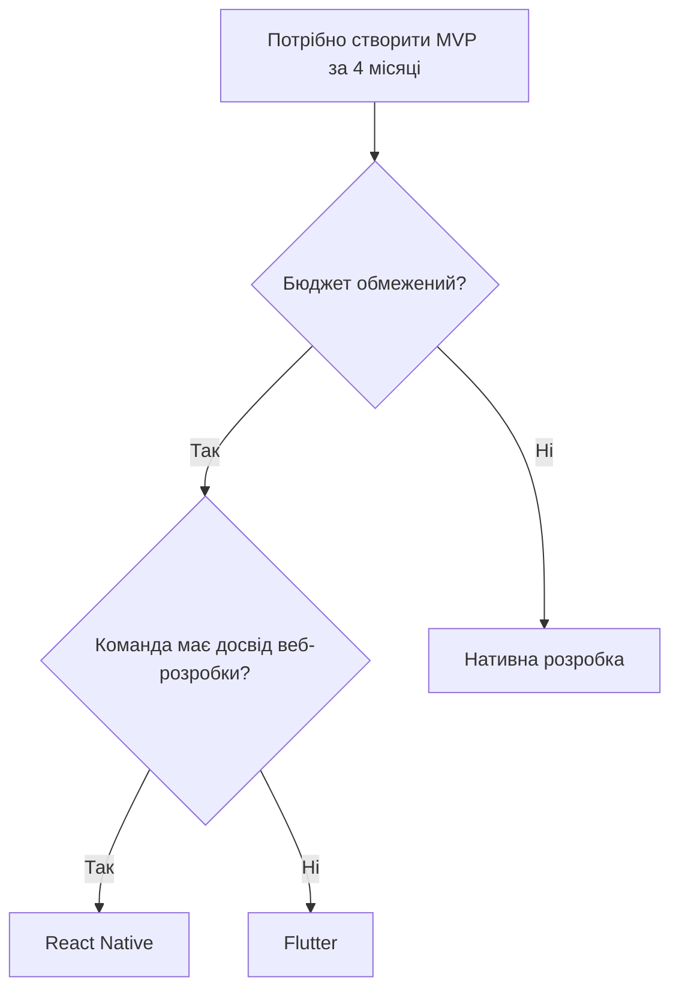

# Практична робота №1

## Загальний огляд мобільних платформ

### Варіант 1. Вибір стека для стартапу-маркетплейсу

## Постановка задачі

Стартап розробляє маркетплейс послуг. До запуску MVP залишилося 4 місяці. Бюджет обмежений, а команда складається з двох розробників із досвідом веб-фронтенду.

Необхідно визначити, яка технологія краще підходить для розробки мобільного застосунку: Flutter, React Native чи нативна розробка.

## Порівняння технологій

| Критерій | Flutter | React Native | Нативна розробка |
|-----------|----------|--------------|------------------|
| Вартість розробки | Низька | Низька | Висока |
| Термін виходу MVP | 3-4 місяці | 3-4 місяці | 6-8 місяців |
| Поріг входу для команди | Середній | Низький | Високий |
| Доступ до платіжних SDK | Є | Є | Є |

## Частка ринку мобільних платформ

За даними StatCounter (вересень 2026):

| Платформа | Частка ринку |
|-----------|-------------|
| Android | 69,17 % |
| iOS | 30,81 % |

## Ризики

| Технологія | Android | iOS |
|------------|----------|-----|
| Flutter | Проблеми сумісності окремих плагінів | Іноді потрібна реалізація через нативний код |
| React Native | Залежність від сторонніх бібліотек | Можливі проблеми після оновлень iOS |
| Нативна розробка | Вищі витрати на підтримку | Потрібен окремий спеціаліст |

## Дерево рішень

## Рекомендація

Для цього проєкту обрано React Native.

Причини вибору:

1. Розробники вже мають досвід роботи з JavaScript.
2. Одна кодова база використовується для Android та iOS.
3. Є готові рішення для інтеграції платіжних систем.

## Контраргумент

Flutter також підходить для розробки маркетплейсу. Він забезпечує стабільний інтерфейс на різних платформах і часто використовується для створення застосунків з великою кількістю власних елементів інтерфейсу.

## За яких умов вибір може змінитися

Flutter може стати кращим варіантом, якщо основний акцент буде зроблено на дизайні та складному інтерфейсі.

Нативна розробка може бути виправдана у випадку збільшення бюджету або появи вимог до використання специфічних можливостей Android чи iOS.

## Висновок

Після порівняння Flutter, React Native та нативної розробки було обрано React Native.

Перевагами цього рішення є швидший старт для поточної команди, можливість використовувати одну кодову базу для двох платформ і наявність готових платіжних SDK.

Ризик полягає в залежності від сторонніх бібліотек та їх сумісності з новими версіями Android і iOS.

## Джерела

1. https://gs.statcounter.com/os-market-share/mobile/worldwide
2. https://developer.android.com/
3. https://developer.apple.com/
4. https://flutter.dev/
5. https://reactnative.dev/
6. https://mermaid.js.org/

Дата звернення: 09.10.2026
